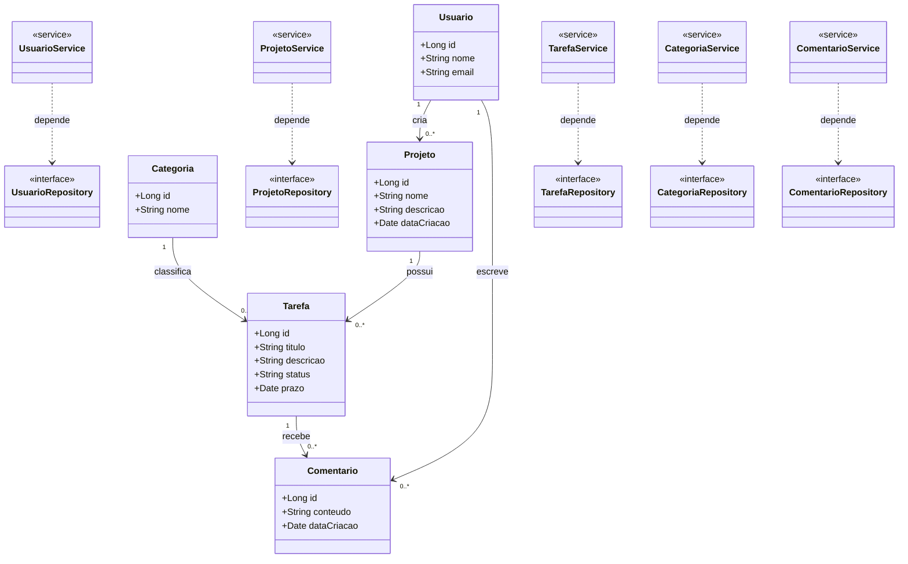

# Modelagem de Classes — Gerenciamento de Tarefas

**Aluno:** Flórido Diniz  
**Domínio:** Gerenciamento de Tarefas

## 1. Domínio

O sistema de gerenciamento de tarefas permite organizar atividades em projetos, atribuir responsáveis e acompanhar o andamento das tarefas. Também possibilita classificar atividades por categorias e registrar comentários para facilitar a comunicação entre os usuários.

## 2. Entidades

- **Usuario:** representa uma pessoa cadastrada no sistema, responsável por criar projetos e interagir com as tarefas.
- **Projeto:** agrupa tarefas relacionadas a um mesmo objetivo e possui um usuário responsável.
- **Tarefa:** representa uma atividade vinculada a um projeto, com título, descrição, prazo e status.
- **Categoria:** permite classificar e organizar tarefas por assunto ou finalidade.
- **Comentario:** registra observações realizadas por usuários sobre determinada tarefa.

## 3. Diagrama de Classes

## 4. Responsabilidades de Services e Repositories

| Entidade | Service | Repository |
|---|---|---|
| Usuario | Gerenciar cadastro, atualização e validação de usuários. | Persistir, consultar, atualizar e excluir usuários. |
| Projeto | Gerenciar projetos e validar seus responsáveis. | Persistir e consultar projetos e seus responsáveis. |
| Tarefa | Gerenciar tarefas, prazos, status e categorias. | Persistir, consultar e atualizar tarefas. |
| Categoria | Gerenciar categorias e validar seus dados. | Persistir e consultar categorias. |
| Comentario | Gerenciar comentários e validar sua associação com usuários e tarefas. | Persistir e consultar comentários. |

## 5. Aplicação dos princípios SRP e DIP

O princípio **SRP (Single Responsibility Principle)** é aplicado ao separar as responsabilidades entre entidades, Services e Repositories. Cada componente possui uma responsabilidade específica: as entidades representam os dados e regras do domínio, os Services concentram as regras de negócio e os Repositories cuidam do acesso aos dados.

O princípio **DIP (Dependency Inversion Principle)** é aplicado fazendo com que os Services dependam de interfaces de Repository, e não de implementações concretas de persistência. Dessa forma, é possível substituir a tecnologia de armazenamento sem precisar modificar as regras de negócio.

## 6. Fora do escopo (YAGNI)

Neste momento, o sistema não contemplará funcionalidades como notificações automáticas, anexos em tarefas, integração com calendários externos, relatórios avançados ou controle de permissões detalhado. Essas funcionalidades poderão ser adicionadas futuramente caso exista uma necessidade real.